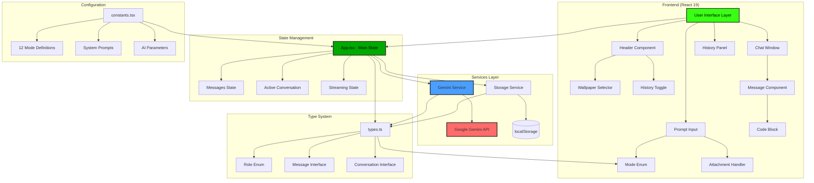
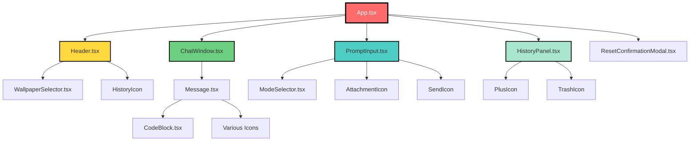
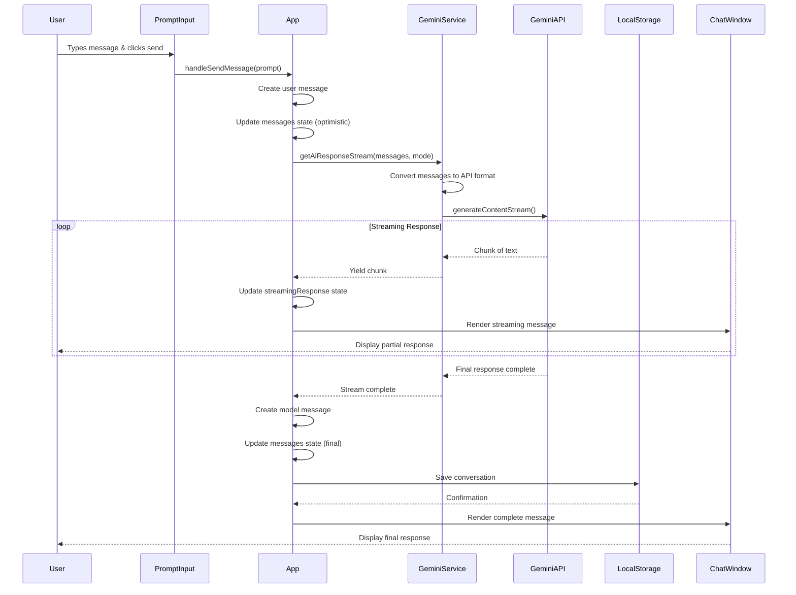
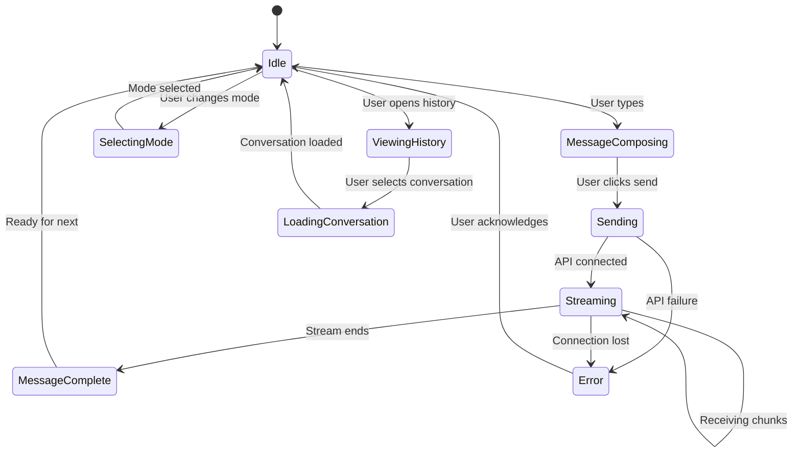

# AIT PROfessor - Architecture Documentation

## System Architecture Overview



## Component Hierarchy



## Data Flow Architecture



## State Management Flow



## File Structure

```
/workspace
├── App.tsx                           # Main application orchestrator
├── index.tsx                         # React entry point
├── types.ts                          # TypeScript type definitions
├── constants.tsx                     # Mode configurations & prompts
│
├── components/
│   ├── ChatWindow.tsx               # Message display container
│   ├── PromptInput.tsx              # User input with attachments
│   ├── Header.tsx                   # Top navigation bar
│   ├── HistoryPanel.tsx             # Conversation history sidebar
│   ├── ModeSelector.tsx             # AI mode switcher
│   ├── WallpaperSelector.tsx        # Background customization
│   ├── Message.tsx                  # Individual message renderer
│   ├── ResetConfirmationModal.tsx   # Data erasure confirmation
│   │
│   ├── ui/
│   │   └── CodeBlock.tsx            # Syntax-highlighted code display
│   │
│   └── icons/                       # 25 custom SVG icons
│       ├── ProfessorIcon.tsx
│       ├── CodeIcon.tsx
│       ├── SecurityIcon.tsx
│       └── ... (22 more icons)
│
├── services/
│   ├── geminiService.ts             # AI API integration layer
│   └── localStorageService.ts      # Persistent storage manager
│
├── constants/
│   └── wallpapers.ts                # UI theme definitions
│
├── vite.config.ts                   # Build configuration
├── tsconfig.json                    # TypeScript config
├── package.json                     # Dependencies
└── index.html                       # HTML entry point
```

## Technology Stack Deep Dive

### Frontend Layer
```yaml
Framework: React 19.1.0
  - Why: Latest features, improved performance
  - Hooks: useState, useEffect, useCallback, useRef
  - No Context API: Simple prop drilling for this scale

Language: TypeScript 5.8.2
  - Why: Type safety, better IDE support
  - Strict mode: Enabled
  - Target: ES2022

Build Tool: Vite 6.2.0
  - Why: Fast HMR, modern bundling
  - Dev Server: Port 3000, hot reload
  - Build: Optimized production bundles

Styling: Tailwind CSS (CDN)
  - Why: Rapid development, consistent design
  - Custom theme: Cyberpunk/hacker aesthetic
  - Colors: Electric lime (#39ff14) on dark (#040504)
```

### AI Layer
```yaml
Provider: Google Gemini
  - Model: gemini-2.5-flash
  - Why: Multimodal, fast, cost-effective
  - Features:
    - Streaming responses
    - Image/audio/text input
    - System instructions per mode
    - Configurable temperature/topK/topP

Integration: @google/genai SDK 1.8.0
  - Native streaming support
  - TypeScript types included
  - Browser-compatible
```

### Storage Layer
```yaml
Primary: localStorage (Browser API)
  - Capacity: 5-10MB (browser-dependent)
  - Format: JSON serialization
  - Keys:
    - 'ait_professor_history': Conversation array
    - 'ait_professor_active_convo_id': Active conversation ID
  
  - Data Structure:
    {
      id: string,
      title: string,
      timestamp: ISO 8601 string,
      messages: Message[]
    }

Limitations:
  - No encryption
  - No sync across devices
  - Quota limits
  - Cleared on cache clear

Future: PostgreSQL + Redis (planned Phase 4)
```

## Key Design Patterns

### 1. **Mode-Based Architecture**
Each AI mode has its own:
- System prompt
- Temperature setting
- TopK/TopP parameters
- Icon and color theme

Benefits:
- Consistent specialized behavior
- Easy to add new modes
- Clear user mental model

### 2. **Optimistic UI Updates**
Pattern:
1. User sends message
2. Immediately add to UI
3. Call API
4. On success: Keep it
5. On failure: Roll back + show error

Benefits:
- Feels instant
- Better UX
- Handles errors gracefully

### 3. **Streaming Response Rendering**
Pattern:
1. Start with empty response
2. Append each chunk to state
3. Re-render message component
4. Finalize on stream end

Benefits:
- Real-time feedback
- Feels conversational
- Lower perceived latency

### 4. **Service Layer Abstraction**
Pattern:
```
UI Component
   ↓
App State
   ↓
Service Layer (geminiService.ts)
   ↓
External API
```

Benefits:
- Easy to swap AI providers
- Testable in isolation
- Clean separation of concerns

## Security Architecture

### Current State (⚠️ Vulnerable)
```
Browser → [API Key in Code] → Gemini API
```
**Risk:** API key exposed in browser, can be stolen

### Planned State (✅ Secure)
```
Browser → Backend Proxy → [API Key in Env] → Gemini API
          ↓
      Rate Limiting
      Authentication
      Request Validation
```

### Security Measures to Implement

1. **API Key Protection**
   ```javascript
   // Frontend (old - INSECURE)
   const API_KEY = process.env.API_KEY;
   const ai = new GoogleGenAI({ apiKey: API_KEY });
   
   // Frontend (new - SECURE)
   const response = await fetch('/api/chat', {
     method: 'POST',
     headers: { 'Authorization': `Bearer ${userToken}` },
     body: JSON.stringify({ messages, mode })
   });
   
   // Backend proxy (new)
   app.post('/api/chat', authenticate, rateLimit, async (req, res) => {
     const { messages, mode } = req.body;
     const ai = new GoogleGenAI({ apiKey: process.env.GEMINI_API_KEY });
     // Forward request...
   });
   ```

2. **Content Security Policy**
   ```html
   <meta http-equiv="Content-Security-Policy" 
         content="default-src 'self'; 
                  script-src 'self' 'unsafe-inline' cdn.tailwindcss.com esm.sh; 
                  connect-src 'self' https://api.yourdomain.com;">
   ```

3. **Input Validation**
   ```typescript
   const validateMessage = (content: string): boolean => {
     if (content.length > 10000) return false; // Max length
     if (/<script>/i.test(content)) return false; // XSS protection
     return true;
   };
   ```

## Performance Optimization Strategies

### Current Performance
- Bundle size: ~200KB (unoptimized)
- First load: ~1.5s
- Streaming start: ~500ms
- Memory usage: ~50MB

### Optimization Opportunities

1. **Code Splitting**
   ```javascript
   // Lazy load heavy components
   const HistoryPanel = lazy(() => import('./components/HistoryPanel'));
   const WallpaperSelector = lazy(() => import('./components/WallpaperSelector'));
   ```

2. **Memoization**
   ```javascript
   // Prevent unnecessary re-renders
   const MemoizedMessage = memo(Message);
   const memoizedModes = useMemo(() => MODES, []);
   ```

3. **Virtual Scrolling**
   ```javascript
   // For long conversation histories
   import { FixedSizeList } from 'react-window';
   ```

4. **Image Optimization**
   ```javascript
   // Compress attachments before upload
   const compressImage = async (file: File): Promise<Blob> => {
     // Use canvas API to resize/compress
   };
   ```

## Deployment Architecture

### Current (AI Studio)
```
User Browser
    ↓
AI Studio CDN
    ↓
Static Files (HTML/JS/CSS)
    ↓
Gemini API (Direct)
```

### Proposed (Production)
```
User Browser
    ↓
Cloudflare CDN (Global)
    ↓
Frontend (Vercel Edge)
    ↓
Backend API (Railway/Render)
    ↓
PostgreSQL (Supabase)
    ↓
Gemini API
```

## Testing Strategy

### Unit Tests (Target: 80% coverage)
```
services/
  ├── geminiService.test.ts
  │   ✓ Converts messages correctly
  │   ✓ Handles streaming
  │   ✓ Error handling
  │
  └── localStorageService.test.ts
      ✓ Saves conversations
      ✓ Loads conversations
      ✓ Handles corrupted data

components/
  ├── Message.test.tsx
  │   ✓ Renders user messages
  │   ✓ Renders model messages
  │   ✓ Shows attachments
  │
  └── PromptInput.test.tsx
      ✓ Handles text input
      ✓ File uploads
      ✓ Keyboard shortcuts
```

### E2E Tests (Playwright)
```
tests/
  ├── happy-path.spec.ts
  │   → Send message, receive response
  │
  ├── attachments.spec.ts
  │   → Upload image, get analysis
  │
  ├── history.spec.ts
  │   → Create, view, delete conversations
  │
  └── modes.spec.ts
      → Switch modes, verify behavior
```

## Monitoring & Observability

### Metrics to Track
```yaml
Performance:
  - API response time (p50, p95, p99)
  - Bundle load time
  - Time to First Byte
  - Streaming latency

Errors:
  - API failures (rate, type)
  - localStorage quota exceeded
  - Network timeouts
  - Unhandled exceptions

Usage:
  - Messages per session
  - Mode distribution
  - Attachment types
  - Conversation length
```

### Tools (Recommended)
- **Sentry**: Error tracking
- **LogRocket**: Session replay
- **Mixpanel**: User analytics
- **Lighthouse**: Performance audits

## Scalability Considerations

### Current Limits
- Single user per browser
- No authentication
- localStorage cap (5-10MB)
- No rate limiting
- No caching

### Scaling Path
```
Phase 1: 0-1K users
  → Current architecture works
  → Focus on stability

Phase 2: 1K-10K users
  → Add backend proxy
  → Implement user auth
  → Move to cloud DB

Phase 3: 10K-100K users
  → Microservices architecture
  → Dedicated AI inference service
  → CDN for global reach
  → Redis caching layer

Phase 4: 100K+ users
  → Kubernetes orchestration
  → Multi-region deployment
  → Message queue for async tasks
  → Advanced load balancing
```

---

## API Reference

### Gemini Service API

#### `getAiResponseStream(messages, modeInfo)`
Sends conversation history to Gemini API and returns streaming response.

**Parameters:**
- `messages: Message[]` - Array of conversation messages
- `modeInfo?: ModeInfo` - Optional mode configuration

**Returns:**
- `AsyncGenerator<GenerateContentResponse>` - Streaming response chunks

**Example:**
```typescript
const stream = await getAiResponseStream(messages, MODES[0]);
for await (const chunk of stream) {
  console.log(chunk.text);
}
```

### LocalStorage Service API

#### `saveHistory(history)`
Persists conversation history to localStorage.

#### `getHistory()`
Retrieves all conversations from localStorage.

#### `saveActiveConversationId(id)`
Saves the currently active conversation ID.

#### `getActiveConversationId()`
Retrieves the active conversation ID.

#### `clearHistory()`
Deletes all conversation data.

---

*For implementation details, see the full [Development Roadmap](./DEVELOPMENT_ROADMAP_AND_ANALYTICS_REPORT.md).*
