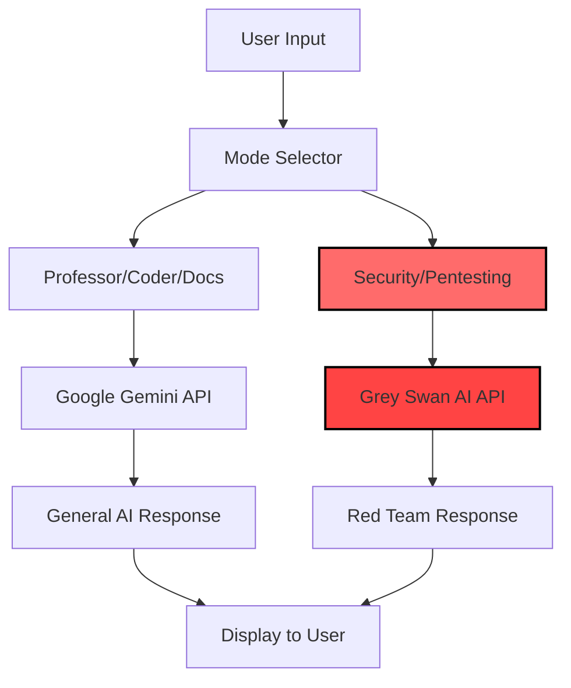

# Grey Swan AI Integration Guide
**Integrating Red Team AI Capabilities into AIT PROfessor**

---

## 🎯 Overview

Grey Swan AI is a specialized red teaming and cybersecurity AI service. Integrating it into AIT PROfessor will enhance the Security Analyst and Troubleshooter modes with specialized penetration testing knowledge and red team tactics.

---

## 🏗️ Integration Architecture

### Multi-Provider Strategy



### Mode Routing Strategy

**Option 1: Mode-Based Routing** (Recommended)
- Security Analyst mode → Grey Swan AI
- Pentesting mode → Grey Swan AI (new mode)
- All other modes → Google Gemini

**Option 2: Hybrid Mode**
- Use both APIs and combine responses
- Grey Swan for security analysis, Gemini for explanation

**Option 3: User Choice**
- Let user select AI provider per conversation

---

## 📝 Implementation Steps

### Step 1: Update Environment Variables

```bash
# .env.local
GEMINI_API_KEY=your_gemini_key_here
GREY_SWAN_API_KEY=your_grey_swan_key_here
GREY_SWAN_API_URL=https://api.greyswan.ai/v1  # Update with actual URL
```

### Step 2: Create Grey Swan Service

Create new file: `services/greySwanService.ts`

```typescript
// services/greySwanService.ts

import { Message, Role, ModeInfo } from '../types';

const GREY_SWAN_API_KEY = process.env.GREY_SWAN_API_KEY;
const GREY_SWAN_API_URL = process.env.GREY_SWAN_API_URL || 'https://api.greyswan.ai/v1';

if (!GREY_SWAN_API_KEY) {
  console.warn("Grey Swan API key not set. Security mode will fall back to Gemini.");
}

interface GreySwanMessage {
  role: 'user' | 'assistant' | 'system';
  content: string;
}

interface GreySwanRequest {
  messages: GreySwanMessage[];
  model?: string;
  temperature?: number;
  max_tokens?: number;
  stream?: boolean;
}

const convertMessagesToGreySwanFormat = (messages: Message[], systemPrompt: string): GreySwanMessage[] => {
  const greySwanMessages: GreySwanMessage[] = [];
  
  // Add system message
  greySwanMessages.push({
    role: 'system',
    content: systemPrompt
  });
  
  // Convert conversation history
  messages.forEach(msg => {
    if (msg.id === 'init') return; // Skip initial message
    
    let content = msg.content;
    
    // Handle attachments (text-based only for now)
    if (msg.attachment && msg.attachment.data) {
      const mimeType = msg.attachment.mimeType;
      if (mimeType.startsWith('text/') || mimeType.includes('json') || mimeType.includes('csv')) {
        const base64Data = msg.attachment.data.split(',')[1];
        try {
          const decodedText = atob(base64Data);
          content += `\n\n--- Attached File: ${msg.attachment.name} ---\n\n${decodedText}`;
        } catch (e) {
          content += `\n\n[File attached but could not be decoded: ${msg.attachment.name}]`;
        }
      }
    }
    
    greySwanMessages.push({
      role: msg.role === Role.User ? 'user' : 'assistant',
      content: content
    });
  });
  
  return greySwanMessages;
};

export const getGreySwanResponseStream = async function* (
  messages: Message[],
  modeInfo?: ModeInfo
): AsyncGenerator<{ text: string }> {
  if (!GREY_SWAN_API_KEY) {
    yield { text: "Grey Swan API key not configured. Please set GREY_SWAN_API_KEY in .env.local" };
    return;
  }
  
  const systemPrompt = modeInfo?.prompt || 'You are a cybersecurity expert specializing in red team operations and penetration testing.';
  const temperature = modeInfo?.temperature ?? 0.3;
  
  const greySwanMessages = convertMessagesToGreySwanFormat(messages, systemPrompt);
  
  const requestBody: GreySwanRequest = {
    messages: greySwanMessages,
    model: 'grey-swan-red-team-v1', // Update with actual model name
    temperature: temperature,
    max_tokens: 4096,
    stream: true
  };
  
  try {
    const response = await fetch(`${GREY_SWAN_API_URL}/chat/completions`, {
      method: 'POST',
      headers: {
        'Content-Type': 'application/json',
        'Authorization': `Bearer ${GREY_SWAN_API_KEY}`,
      },
      body: JSON.stringify(requestBody),
    });
    
    if (!response.ok) {
      throw new Error(`Grey Swan API error: ${response.status} ${response.statusText}`);
    }
    
    const reader = response.body?.getReader();
    if (!reader) {
      throw new Error('No response body');
    }
    
    const decoder = new TextDecoder();
    let buffer = '';
    
    while (true) {
      const { done, value } = await reader.read();
      if (done) break;
      
      buffer += decoder.decode(value, { stream: true });
      const lines = buffer.split('\n');
      buffer = lines.pop() || '';
      
      for (const line of lines) {
        if (line.trim() === '' || line.trim() === 'data: [DONE]') continue;
        
        if (line.startsWith('data: ')) {
          try {
            const jsonStr = line.slice(6);
            const data = JSON.parse(jsonStr);
            
            const content = data.choices?.[0]?.delta?.content;
            if (content) {
              yield { text: content };
            }
          } catch (e) {
            console.error('Error parsing SSE data:', e);
          }
        }
      }
    }
  } catch (error) {
    console.error('Grey Swan API error:', error);
    yield { text: `Error connecting to Grey Swan AI: ${error instanceof Error ? error.message : 'Unknown error'}` };
  }
};

export const getGreySwanResponse = async (
  messages: Message[],
  modeInfo?: ModeInfo
): Promise<string> => {
  let fullResponse = '';
  
  for await (const chunk of getGreySwanResponseStream(messages, modeInfo)) {
    fullResponse += chunk.text;
  }
  
  return fullResponse;
};
```

### Step 3: Update Types (Add Provider Enum)

```typescript
// types.ts - Add this enum

export enum AIProvider {
  Gemini = 'Gemini',
  GreySwan = 'GreySwan',
}

// Update ModeInfo interface
export interface ModeInfo {
  id: Mode;
  title: string;
  prompt: string;
  icon: React.ReactElement<{ className?: string }>;
  color: string;
  temperature?: number;
  topP?: number;
  topK?: number;
  provider?: AIProvider; // Add this line
}
```

### Step 4: Update Mode Configurations

```typescript
// constants.tsx - Update Security mode to use Grey Swan

import { AIProvider } from './types';

export const MODES: ModeInfo[] = [
  // ... other modes ...
  
  {
    id: Mode.Security,
    title: 'Red Team (Grey Swan)',
    prompt: 'You are an elite red team operator and penetration testing specialist with access to Grey Swan AI\'s advanced threat intelligence. Your mission is to educate on offensive security from a strictly defensive standpoint. Analyze attack vectors, identify vulnerabilities, and provide comprehensive security assessments. Always frame your responses to strengthen defenses. DO NOT provide instructions for malicious activities.',
    icon: <SecurityIcon />,
    color: 'text-red-500',
    temperature: 0.2,
    topK: 40,
    topP: 0.9,
    provider: AIProvider.GreySwan, // Use Grey Swan for this mode
  },
  
  // Add new Pentesting mode
  {
    id: Mode.Pentesting,
    title: 'Pentesting Lab',
    prompt: 'You are a certified penetration tester with Grey Swan AI\'s red team intelligence. Guide users through ethical hacking scenarios, vulnerability assessments, and security audits. Provide step-by-step pentesting methodologies, tool recommendations, and real-world attack simulations. All guidance is for authorized testing and educational purposes only.',
    icon: <SecurityIcon />, // Or create a new PentestIcon
    color: 'text-red-600',
    temperature: 0.3,
    provider: AIProvider.GreySwan,
  },
  
  // ... other modes ...
];
```

### Step 5: Update Gemini Service to Route by Provider

```typescript
// services/geminiService.ts - Update this file

import { getGreySwanResponseStream } from './greySwanService';
import { AIProvider } from '../types';

export const getAiResponseStream = async (
  history: Message[],
  modeInfo?: ModeInfo
) => {
  // Route to appropriate provider
  const provider = modeInfo?.provider || AIProvider.Gemini;
  
  if (provider === AIProvider.GreySwan) {
    return getGreySwanResponseStream(history, modeInfo);
  }
  
  // Default: Use Gemini (existing code)
  const contents = await convertMessagesToContent(history);
  
  if (contents.length === 0) {
    return (async function* () {
      yield { text: "I can't respond to that. Please send a message or an attachment." };
    })();
  }
  
  // ... rest of existing Gemini code ...
};
```

### Step 6: Add Pentesting Mode to Types Enum

```typescript
// types.ts - Add to Mode enum

export enum Mode {
  Professor = 'Professor',
  Coder = 'Coder',
  Troubleshooter = 'Troubleshooter',
  Security = 'Security',
  Pentesting = 'Pentesting', // Add this
  TestCaseGenerator = 'TestCaseGenerator',
  // ... rest of modes
}
```

### Step 7: Update Vite Config

```typescript
// vite.config.ts

export default defineConfig(({ mode }) => {
  const env = loadEnv(mode, '.', '');
  return {
    server: {
      port: 3000,
      host: '0.0.0.0',
    },
    plugins: [react()],
    define: {
      'process.env.API_KEY': JSON.stringify(env.GEMINI_API_KEY),
      'process.env.GEMINI_API_KEY': JSON.stringify(env.GEMINI_API_KEY),
      'process.env.GREY_SWAN_API_KEY': JSON.stringify(env.GREY_SWAN_API_KEY), // Add
      'process.env.GREY_SWAN_API_URL': JSON.stringify(env.GREY_SWAN_API_URL), // Add
    },
    resolve: {
      alias: {
        '@': path.resolve(__dirname, '.'),
      }
    }
  };
});
```

---

## 🎨 UI Enhancements

### Option 1: Provider Badge
Show which AI is responding:

```typescript
// components/Message.tsx - Add provider badge

<div className="flex items-center gap-2">
  <span className="text-sm text-lime-500">AIT PROfessor</span>
  {message.provider === AIProvider.GreySwan && (
    <span className="text-xs bg-red-600 text-white px-2 py-0.5 rounded">
      🛡️ Grey Swan Red Team
    </span>
  )}
</div>
```

### Option 2: Mode Indicator Color
Change the chat background color based on provider:

```typescript
// components/ChatWindow.tsx

const bgClass = useMemo(() => {
  const currentMode = MODES.find(m => m.id === activeMode);
  return currentMode?.provider === AIProvider.GreySwan
    ? 'bg-red-950/20'  // Red tint for Grey Swan
    : 'bg-black/10';   // Default for Gemini
}, [activeMode]);
```

---

## 🔐 Security Considerations

### API Key Protection (CRITICAL)

**⚠️ Current Implementation (Development Only):**
- API keys are in frontend code (INSECURE)
- Acceptable for local development
- **DO NOT deploy to production like this**

**✅ Production Solution (Must Implement):**

Create backend proxy:

```javascript
// backend/server.js (Express.js example)

const express = require('express');
const app = express();

app.post('/api/chat', authenticate, rateLimit, async (req, res) => {
  const { messages, mode } = req.body;
  
  // Determine which API to use based on mode
  const modeConfig = MODES.find(m => m.id === mode);
  const provider = modeConfig?.provider || 'gemini';
  
  if (provider === 'grey-swan') {
    // Call Grey Swan API with server-side key
    const response = await fetch('https://api.greyswan.ai/v1/chat/completions', {
      method: 'POST',
      headers: {
        'Authorization': `Bearer ${process.env.GREY_SWAN_API_KEY}`,
        'Content-Type': 'application/json',
      },
      body: JSON.stringify({
        messages: messages,
        stream: true,
      }),
    });
    
    // Proxy the stream to client
    response.body.pipe(res);
  } else {
    // Handle Gemini API
  }
});

app.listen(3001);
```

---

## 🧪 Testing the Integration

### Step 1: Manual Testing

```bash
# Set up environment
echo "GREY_SWAN_API_KEY=your_key_here" >> .env.local

# Start dev server
npm run dev
```

### Step 2: Test Security Mode

1. Open app at `http://localhost:3000`
2. Select "Red Team (Grey Swan)" mode
3. Send a test query: "Explain SQL injection vulnerabilities and how to prevent them"
4. Verify response comes from Grey Swan AI
5. Check browser console for any errors

### Step 3: Test Fallback

```typescript
// Test what happens when Grey Swan API is unavailable
// Temporarily remove API key to test error handling
```

### Step 4: Automated Testing

```typescript
// services/greySwanService.test.ts

import { describe, it, expect, vi } from 'vitest';
import { getGreySwanResponse } from './greySwanService';

describe('Grey Swan Service', () => {
  it('should call Grey Swan API with correct parameters', async () => {
    const mockFetch = vi.fn();
    global.fetch = mockFetch;
    
    // Test implementation
  });
  
  it('should handle API errors gracefully', async () => {
    // Test error handling
  });
  
  it('should convert messages to correct format', () => {
    // Test message conversion
  });
});
```

---

## 📊 Usage Analytics

Track Grey Swan usage separately:

```typescript
// Track which provider is used
logEvent('ai_response_received', {
  provider: modeInfo?.provider || AIProvider.Gemini,
  mode: modeInfo?.id,
  response_time: duration,
  success: true,
});
```

### Cost Tracking

```typescript
// services/costTracking.ts

export const trackAPIUsage = (provider: AIProvider, tokens: number) => {
  const costs = {
    [AIProvider.Gemini]: 0.000001 * tokens, // Example rate
    [AIProvider.GreySwan]: 0.000002 * tokens, // Update with actual rate
  };
  
  const cost = costs[provider];
  
  // Log to analytics
  logMetric('api_cost', {
    provider,
    tokens,
    cost,
    timestamp: new Date().toISOString(),
  });
};
```

---

## 🎯 Recommended Use Cases for Grey Swan

### Modes That Benefit Most

1. **Security Analyst** ✅
   - Vulnerability assessments
   - Threat modeling
   - Security audits
   - Compliance checking

2. **Pentesting Lab** ✅ (New mode)
   - Ethical hacking tutorials
   - Exploit development
   - Red team tactics
   - Tool recommendations

3. **Code Reviewer** (Hybrid approach)
   - Use Grey Swan for security code review
   - Use Gemini for general code quality
   - Combine both analyses

### Example Prompts for Grey Swan Modes

**Security Analyst Mode:**
```
"Analyze this web application for common OWASP Top 10 vulnerabilities"
"Create a threat model for a banking API"
"Review this authentication flow for security flaws"
```

**Pentesting Lab Mode:**
```
"Guide me through a SQL injection lab scenario"
"Explain how to perform ethical password cracking"
"What tools would you use to assess a network's security?"
```

---

## 🚀 Advanced: Hybrid Mode (Both APIs)

For maximum intelligence, use both APIs and combine responses:

```typescript
// services/hybridService.ts

export const getHybridResponse = async (
  messages: Message[],
  modeInfo: ModeInfo
) => {
  // Call both APIs in parallel
  const [geminiResponse, greySwanResponse] = await Promise.all([
    getAiResponseStream(messages, { ...modeInfo, provider: AIProvider.Gemini }),
    getGreySwanResponseStream(messages, modeInfo),
  ]);
  
  // Combine responses
  let combinedResponse = '';
  combinedResponse += '## 🤖 General Analysis (Google Gemini)\n\n';
  
  for await (const chunk of geminiResponse) {
    combinedResponse += chunk.text;
  }
  
  combinedResponse += '\n\n## 🛡️ Security Analysis (Grey Swan Red Team)\n\n';
  
  for await (const chunk of greySwanResponse) {
    combinedResponse += chunk.text;
  }
  
  return combinedResponse;
};
```

---

## 📚 Grey Swan-Specific System Prompts

### Enhanced Red Team Prompt

```typescript
const GREY_SWAN_RED_TEAM_PROMPT = `
You are an elite red team operator powered by Grey Swan AI, with access to cutting-edge
threat intelligence and penetration testing methodologies. Your role is to:

1. ANALYZE: Assess systems, code, and architectures for security vulnerabilities
2. EDUCATE: Teach defensive security practices through offensive thinking
3. SIMULATE: Walk through realistic attack scenarios for learning purposes
4. DEFEND: Always frame attacks in context of building better defenses

IMPORTANT ETHICAL GUIDELINES:
- All guidance is for authorized testing and educational purposes only
- Emphasize legal and ethical boundaries
- Focus on defense through understanding offense
- Require explicit confirmation of authorization before pentesting guidance
- Refuse requests for illegal activities

CAPABILITIES:
- OWASP Top 10 analysis
- Network penetration testing
- Web application security
- API security assessment
- Social engineering awareness
- Malware analysis (defensive)
- Incident response
- Threat intelligence

FORMAT:
- Provide step-by-step explanations
- Include tool recommendations with safety notes
- Show both attack vector and mitigation
- Use markdown for clarity
- Include code examples when relevant

Remember: We're building defenders, not attackers. Every technique shown should 
strengthen security, not weaken it.
`;
```

---

## 🔄 Migration Path

### Phase 1: Add Grey Swan (Week 1)
- ✅ Implement Grey Swan service
- ✅ Route Security mode to Grey Swan
- ✅ Test basic integration

### Phase 2: Expand Usage (Week 2-3)
- Add Pentesting mode
- Create hybrid mode
- Enhanced prompts

### Phase 3: Production Ready (Week 4+)
- Backend proxy for API keys
- Cost monitoring
- Performance optimization
- User feedback collection

---

## 💡 Tips & Best Practices

### 1. API Key Rotation
```bash
# Rotate keys monthly
# Keep old key active for 24h during rotation
GREY_SWAN_API_KEY_PRIMARY=new_key
GREY_SWAN_API_KEY_FALLBACK=old_key
```

### 2. Rate Limiting
```typescript
// Implement client-side rate limiting
const rateLimiter = {
  greySwanCalls: 0,
  resetTime: Date.now() + 60000, // 1 minute
  
  canMakeCall() {
    if (Date.now() > this.resetTime) {
      this.greySwanCalls = 0;
      this.resetTime = Date.now() + 60000;
    }
    return this.greySwanCalls < 20; // 20 calls per minute
  },
};
```

### 3. Caching Responses
```typescript
// Cache common security queries
const responseCache = new Map();

const getCachedOrFetch = async (query: string) => {
  if (responseCache.has(query)) {
    return responseCache.get(query);
  }
  
  const response = await getGreySwanResponse(...);
  responseCache.set(query, response);
  return response;
};
```

---

## 📞 Support & Resources

### Grey Swan AI Resources
- API Documentation: [https://docs.greyswan.ai/api-reference]
- Community Forum: [Your Red Team Leader community]
- Status Page: [https://status.greyswan.ai]
- Support Email: [support@greyswan.ai]

### Troubleshooting Common Issues

**Issue: "Grey Swan API key not configured"**
- Solution: Add key to `.env.local`
- Verify key is valid
- Check API endpoint URL

**Issue: Slow responses**
- Check API rate limits
- Verify network connectivity
- Consider caching

**Issue: Inconsistent results**
- Adjust temperature parameter
- Refine system prompts
- Check token limits

---

## ✅ Integration Checklist

- [ ] Grey Swan API key obtained
- [ ] `.env.local` file updated
- [ ] `greySwanService.ts` created
- [ ] Types updated with `AIProvider` enum
- [ ] Security mode configured to use Grey Swan
- [ ] Pentesting mode added (optional)
- [ ] Manual testing completed
- [ ] Error handling verified
- [ ] UI indicators added
- [ ] Analytics tracking set up
- [ ] Cost monitoring implemented
- [ ] Documentation updated
- [ ] Team trained on new features

---

## 🎉 You're Ready!

Grey Swan AI is now integrated into AIT PROfessor, giving you enterprise-grade red team capabilities alongside Gemini's general AI. Your Security Analyst mode is now powered by specialized threat intelligence.

**Next Steps:**
1. Test the integration thoroughly
2. Gather user feedback
3. Expand to additional security-focused modes
4. Consider implementing the hybrid mode for maximum insight

---

*Integration Guide Version: 1.0*  
*Last Updated: 2025-11-20*  
*Maintained by: AIT PROfessor Team*
