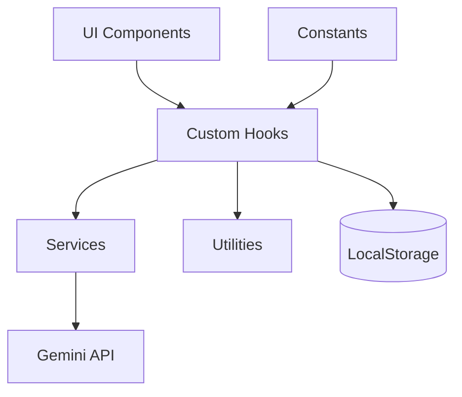

<div align="center">

</div>

# AIT PROfessor

AIT PROfessor is a secure, multimodal AI assistant for IT guidance, coding, troubleshooting, and knowledge exploration. It is built with React + TypeScript and integrates Google Gemini via the client SDK.

View your app in AI Studio: https://ai.studio/apps/drive/1MrISzEPYa68heo6SWQXP9dJEjPb75T35

## Features

- Multi‑mode AI personas (Professor, Coder, Security, etc.)
- Streaming responses with smooth UI updates
- Validated file attachments (image, audio, text)
- Persistent local chat history with recovery
- Built‑in security checks and input validation
- Accessibility‑first UI with keyboard shortcuts

## Architecture



**Key layers**
- **Components**: UI rendering and interaction
- **Hooks**: conversation, streaming, error handling, storage orchestration
- **Services**: Gemini API + localStorage access (no React dependencies)
- **Utils**: validation, error mapping, image compression, type guards

Full details: [docs/Architecture_v1.2.md](./docs/Architecture_v1.2.md)

## Getting Started

**Prerequisites:** Node.js 20+

1. Install dependencies:
   ```bash
   npm install
   ```
2. Copy an env template and add your key:
   ```bash
   cp .env.example .env.local
   ```
3. Set the `API_KEY` or `GEMINI_API_KEY` in `.env.local`.
4. Run the app:
   ```bash
   npm run dev
   ```

## Environment Variables

| Name | Required | Description |
| ---- | -------- | ----------- |
| `API_KEY` | Yes (one of) | Gemini API key |
| `GEMINI_API_KEY` | Yes (one of) | Gemini API key (alternative name) |

Example files:
- `.env.example`
- `.env.development.example`
- `.env.staging.example`
- `.env.production.example`

> **Never commit real API keys.** Use `.env.local` or environment-specific files ignored by git.

## Scripts

| Script | Description |
| ------ | ----------- |
| `npm run dev` | Start dev server |
| `npm run build` | Production build |
| `npm run build:dev` | Build with development mode |
| `npm run build:staging` | Build with staging mode |
| `npm run build:production` | Build with production mode |
| `npm run preview` | Preview production build |
| `npm run analyze` | Bundle size analysis |
| `npm run test` | Run tests (watch) |
| `npm run test:watch` | Run tests (watch) |
| `npm run test:coverage` | Run tests with coverage |

## Testing

Vitest + Testing Library cover utilities, services, components, and integration flows.

```bash
npm run test -- --run
```

## API Integration & Error Handling

**Integration points**
- `services/geminiService.ts` — API key access and Gemini streaming calls
- `hooks/useApiStream.ts` — retries + streaming buffer and UI updates
- `utils/errorHandler.ts` — maps API/network errors to user messages

**Common error handling**
- **401/403**: Authentication failure (invalid/expired key)
- **429**: Rate limit exceeded
- **5xx**: Server error (retryable)
- **Timeout**: Request exceeded 30s timeout
- **Network**: Offline or fetch failures (retryable)

## Security Best Practices

- Never commit or log API keys.
- Keep `.env.local` and `.env.*` out of git.
- Validate all user inputs and file attachments.
- Avoid `dangerouslySetInnerHTML`.
- Use CSP headers in production.

## Privacy

See [PRIVACY.md](./PRIVACY.md) for details on local storage and data handling.

## Monitoring

Performance metrics (Core Web Vitals) and API timings are logged **only in development**. No analytics are enabled by default.

## Deployment Reference

See [docs/DEPLOYMENT.md](./docs/DEPLOYMENT.md) for a Firebase Hosting reference path.

## Support

Support level: **maintained**.

- **Bug reports**: open an issue using the bug report template.
- **Feature requests**: open an issue using the feature request template.

## Troubleshooting

**Build fails with “Missing API key”**
- Provide `API_KEY` or `GEMINI_API_KEY` before running `vite build`.

**No messages saved**
- Check if localStorage is enabled in the browser.

**Tests fail**
- Ensure Node.js 20+, run `npm install`, then `npm run test -- --run`.

## Contributing

See [CONTRIBUTING.md](./CONTRIBUTING.md) for guidelines.
