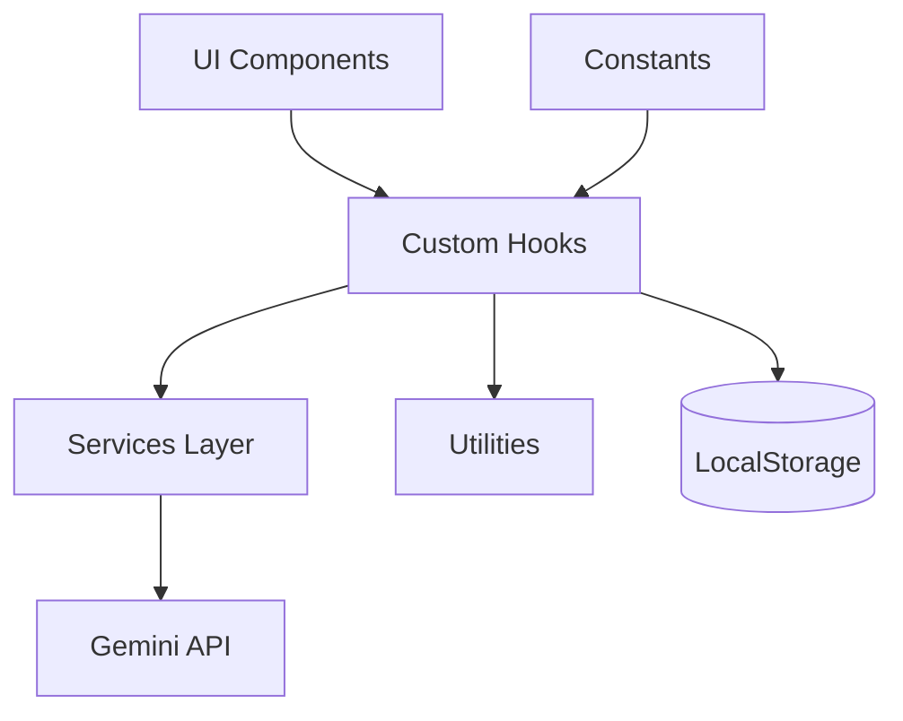

# Architecture v1.2

## Overview

AIT PROfessor is a React + TypeScript single‑page app that streams responses from Google Gemini. The architecture separates UI, hooks, services, and utilities to keep responsibilities clear and testable.

## High‑Level Diagram

## Layers

### Components (UI)
- Presentational and interaction‑focused.
- Accessibility and keyboard shortcuts live here.
- Examples: `Header`, `PromptInput`, `ChatWindow`.

### Hooks (State & Logic)
- **useConversation**: message/history state and persistence.
- **useApiStream**: streaming + retry logic.
- **useLocalStorage**: storage access helpers.
- **useErrorHandler**: normalized error state.

### Services
- **geminiService**: API key access + Gemini streaming request.
- **localStorageService**: low‑level storage reads/writes.

### Utilities
- **validation**: input, file, URL, base64 validation.
- **errorHandler**: error normalization and retry backoff.
- **image**: optional image compression helpers.
- **typeGuards**: runtime type checks for persisted data.

## Data Flow (Conversation)

1. User submits prompt (and optional attachment).
2. `useConversation` stores user message and persists history.
3. `useApiStream` streams model response with retry/backoff.
4. Final response is appended and persisted.

## Persona System

Persona configuration lives in `constants.tsx` (`MODES`). Each `ModeInfo` includes:

- `id` and `title` for UI selection.
- `prompt` for system instruction.
- `temperature`, `topP`, `topK` for behavior tuning.
- `model` for per‑persona model selection.

This enables deterministic personas while keeping UI and API logic decoupled.

## Design Decisions

- **Hooks over monolith**: App coordinates hooks; logic is modular.
- **Strict validation**: all inputs validated before API calls.
- **Streaming updates**: rAF‑driven updates for smooth UI.
- **Environment safety**: build‑time validation for API keys.
